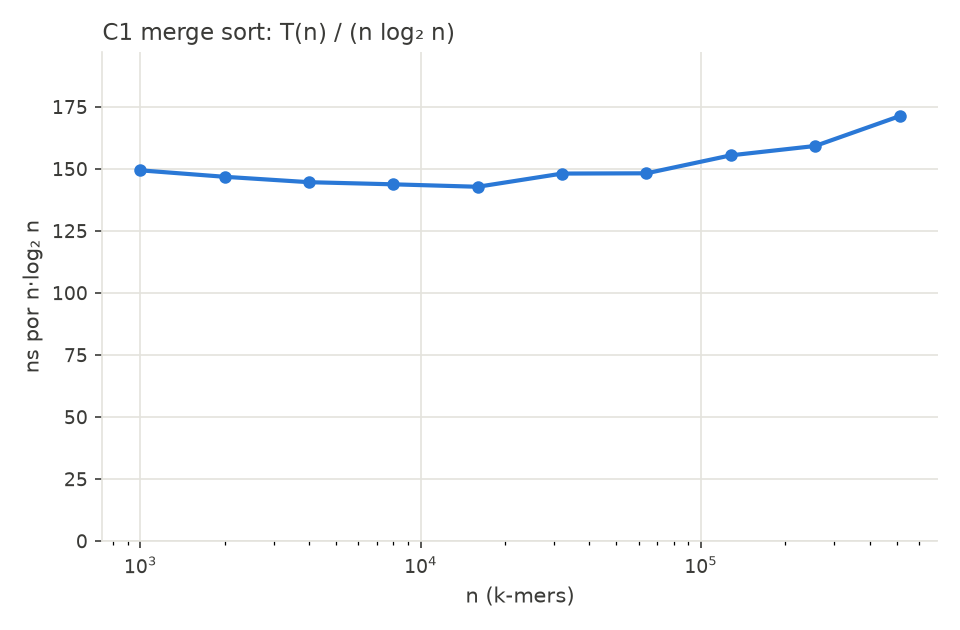
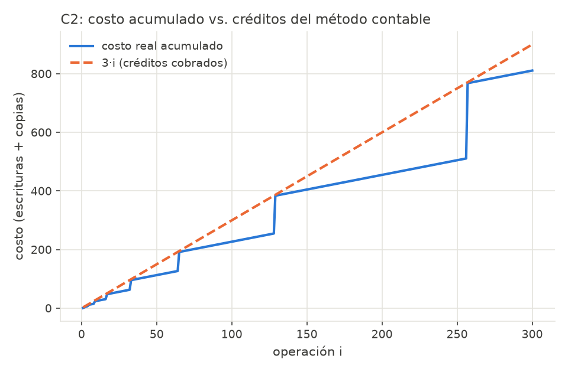
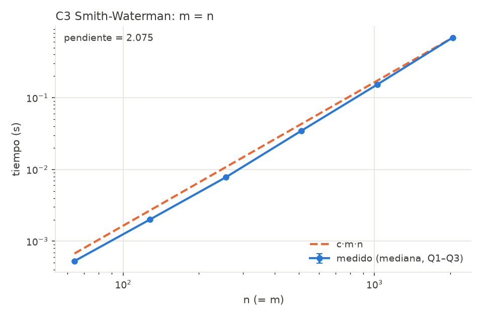

# Avance de la sesión 2: C1, C2 y C3

**Proyecto Final Integrador, Análisis de Algoritmos (SIST0175). Grupo 3: alineamiento de lecturas genómicas con k-mers como semillas.**

Kuilmer Santiago Hernández Cruz · Juan José Berrio Español · Santiago Serrano Cuellar

| Criterio de la rúbrica | Peso | Dónde está |
|---|---|---|
| C1: recurrencia, caso del Teorema Maestro y código que funciona | 35 % | §1 y §2.1 |
| C2: método contable e implementación | 25 % | §1 y §2.2 |
| C3: recurrencia de DP e implementación | 25 % | §1 y §2.3 |
| Plan de experimentos con hipótesis explícitas y generador | 15 % | §3 |

**Responsables:** Santiago Serrano Cuellar (C1 y generador de datos), Juan José Berrio Español (C2 e índice de semillas) y Kuilmer Santiago Hernández Cruz (C3 y alineador). El plan de experimentos se redactó entre los tres.

**El caso.** Un genoma sintético de n bases (A, C, G, T) y lecturas de 50 bases copiadas de él con errores. Para cada lectura hay que encontrar de dónde salió. Se indexan los k-mers del genoma (C1 los ordena y C2 guarda las posiciones de cada uno), se buscan los k-mers de la lectura con búsqueda binaria y solo la región candidata se alinea con Smith-Waterman (C3).

## 1. Código y pruebas

Repositorio `KuilmerHC/genoma-alineamiento` (privado), Python 3.11. El núcleo de los componentes no usa `sorted`, `list.sort` ni `heapq`; `sorted` aparece solo en las pruebas, como oráculo.

| Archivo | Contenido |
|---|---|
| `c1_mergesort/merge_sort.py` | Merge sort con contador de comparaciones |
| `c2_arreglo_dinamico/arreglo_dinamico.py` | Arreglo con duplicación, contadores de costo y banco de créditos |
| `c3_smith_waterman/smith_waterman.py` | Tabla H, retroceso del alineamiento y contador de celdas |
| `comun/kmers.py`, `comun/indice.py`, `comun/alineador.py` | k-mers en 2 bits; índice (C1 + C2 + búsqueda binaria); alineamiento de la región candidata (C3) |
| `datos/generar.py` | Generador de genoma y lecturas con semilla fija |

**Pruebas (`pytest -q`): 97, todas pasan.**

| Pruebas | Qué verifican |
|---|---|
| C1 (6) | Igual que `sorted`; casos borde; comparaciones entre log₂ n! y n log₂ n; mejor caso exacto (n/2)·log₂ n |
| C2 (15) | Lectura y escritura; costo acumulado ≤ 3n hasta n = 10⁵; saldo de créditos nunca negativo |
| C3 (67) | Igual a fuerza bruta en 40 casos; ejemplo clásico de la literatura (puntaje 13); alineamiento coherente con el puntaje; lecturas con errores ubicadas a ≤ 3 bases |
| k-mers e índice (9) | Codificación ida y vuelta; orden entero = alfabético; búsqueda binaria = búsqueda ingenua; 100/100 lecturas ubicadas |

## 2. Análisis teórico

### 2.1 C1: merge sort (divide y vencerás)

**Recurrencia leída del código.** El caso base cuesta Θ(1); copiar las mitades `a[:mid]` y `a[mid:]` cuesta Θ(n); hay dos llamadas recursivas sobre ⌊n/2⌋ y ⌈n/2⌉ elementos; `mezclar` cuesta Θ(n). Por tanto:

```
T(n) = 2·T(n/2) + Θ(n),    T(1) = Θ(1)
```

**Teorema Maestro:** a = 2, b = 2, f(n) = n, y n^(log_b a) = n. Como f(n) = Θ(n^(log_b a)), es el **caso 2**: **T(n) = Θ(n log n)**. Con el árbol de recursión se ve igual: cada uno de los log₂ n niveles cuesta c·n.

| Caso | Entrada que lo provoca | Comparaciones (n potencia de 2) |
|---|---|---|
| Mejor | ya ordenada: una mitad se agota primero | (n/2)·log₂ n |
| Peor | mitades que se intercalan en cada mezcla | n·log₂ n − n + 1 |
| Esperado | permutación aleatoria | ≈ n·log₂ n − 1,25·n |

El tiempo es Θ(n log n) en los tres casos, porque las copias no dependen de los datos. La memoria extra es Θ(n), y el algoritmo es estable (`<=` en la mezcla).

**Cota inferior Ω(n log n).** Un algoritmo que ordena solo comparando es un árbol de decisión binario. Necesita al menos **n!** hojas, una por cada orden posible. Un árbol de altura h tiene a lo sumo 2ʰ hojas, así que 2ʰ ≥ n!, es decir h ≥ log₂ n!. Como n! ≥ (n/2)^(n/2), resulta log₂ n! ≥ (n/2)·log₂(n/2) = Ω(n log n). Merge sort es **óptimo**: su peor caso, n log₂ n − n + 1, solo se aleja ≈ 0,44·n de log₂ n!. La cota vale para el peor caso y el promedio, no para toda entrada: con la entrada ordenada merge sort hace menos (una prueba lo verifica).

### 2.2 C2: arreglo dinámico con duplicación (método contable)

Costo real: 1 por escribir el elemento nuevo y 1 por cada elemento copiado al duplicar. Una operación aislada puede costar Θ(n).

**Créditos:** se cobran **3 por append**. Uno paga la escritura y dos quedan depositados sobre el elemento.

**Invariante: el saldo nunca es negativo.** Al pasar de capacidad c a 2c hay que copiar c elementos. Desde la duplicación anterior (de c/2 a c) entraron c/2 elementos, que dejaron 2 créditos cada uno: c créditos, justo lo necesario. El primer paso (de 1 a 2) se paga con los 2 créditos del primer elemento. Por inducción:

```
costo real de n appends ≤ 3n   ⇒   costo amortizado por append = O(1)
```

Valor exacto: n + 2^⌈log₂ n⌉ − 1 < 3n. La clase lleva el banco en `saldo` y `saldo_minimo`, y una prueba verifica que nunca baja de 0. Acceso a[i] en Θ(1) y memoria Θ(n).

### 2.3 C3: Smith-Waterman (programación dinámica)

Para la lectura a (largo m) y la región b (largo n), con puntajes +2 si las bases coinciden, −1 si no y −2 por hueco, H[i][j] es el mejor puntaje de un alineamiento local que **termina** en aᵢ₋₁ y bⱼ₋₁:

```
H[i][0] = H[0][j] = 0
H[i][j] = max( 0,
               H[i−1][j−1] + s(aᵢ₋₁, bⱼ₋₁),
               H[i−1][j] − 2,
               H[i][j−1] − 2 )          respuesta: el máximo de toda la tabla
```

- **Subestructura óptima.** Si el mejor alineamiento que termina en (i, j) se corta en su última columna, lo que queda tiene que ser óptimo para (i−1, j−1), (i−1, j) o (i, j−1). Si no lo fuera, se reemplazaría por uno mejor y el total mejoraría: contradicción (cortar y pegar).
- **Subproblemas superpuestos.** La recursión ingenua hace ≥ 3^min(m,n) llamadas, pero solo hay (m+1)(n+1) subproblemas distintos.
- **Tabla.** Se llena por filas, así que las tres vecinas ya están calculadas. El 0 permite empezar de nuevo, y eso es lo que hace al alineamiento local. El alineamiento se reconstruye retrocediendo desde la celda máxima hasta un 0.
- **Complejidad:** Θ(mn) en tiempo y memoria en los tres casos, porque la tabla se llena completa siempre. El retroceso es O(m + n). Contra la región candidata (≈ 70 bases) cada lectura cuesta Θ(m²) en vez de Θ(m·n) contra todo el genoma.

## 3. Plan de experimentos

**Protocolo** (`experimentos/bench.py`):
- `time.perf_counter()`, 5 repeticiones por punto, mediana y rango Q1–Q3;
- los datos se generan fuera del tiempo medido;
- al menos 5 tamaños en progresión geométrica (n se duplica);
- pendiente por mínimos cuadrados en log-log y, para n log n, la razón T(n)/(n log n).

En log-log, n log n no es una recta: en el rango 10³–5·10⁵ su pendiente esperada es **≈ 1,10**.

**Generador** (`datos/generar.py`, semilla fija):
- genoma de bases uniformes;
- lecturas de 50 bases con sustituciones (2 %) e inserciones/borrados (0–2 %), y su posición real para medir la exactitud;
- k-mers codificados en 2 bits con ventana deslizante en Θ(n).

| Hipótesis | Datos | Se acepta si |
|---|---|---|
| **H1** C1: T = Θ(n log n); log₂ n! ≤ comparaciones ≤ n log₂ n | n = 10³ … 5,12·10⁵ k-mers (10 tamaños) | pendiente en [1,05; 1,20]; T/(n log n) varía < ±20 %; comparaciones dentro de las cotas |
| **H2** C2: costo < 3n, saldo ≥ 0, T = Θ(n) | n = 10³ … 1,02·10⁶ appends (11 tamaños) | pendiente en [0,95; 1,05]; costo/n < 3; saldo mínimo 0 |
| **H3** C3: T = Θ(mn) | m = 50 con n = 500 … 32 000; m = n = 64 … 2048 | pendiente ≈ 1 con m fijo y ≈ 2 con m = n (±0,1) |
| **H4** C4: E[comparaciones] = 2(n+1)Hₙ − 4n | los mismos tamaños de H1 | medidas/esperadas en [0,85; 1,05] |
| **H5** C5: E/S = 2(N/B)(1 + ⌈log_{M/B−1}(N/M)⌉) | N = 10⁵ … 10⁶, M ≤ N/20 | error < 2 % frente a la fórmula |
| **H6** C6: speedup según la ley de Amdahl | 16 000 lecturas, p = 1 … 16 procesos | speedup a ±15 % del predicho con la fracción serial medida |

**Resultados preliminares** (H1–H3 ya ejecutadas):

| Hipótesis | Pendiente medida | Esperada | Otras métricas | ¿Se acepta? |
|---|---|---|---|---|
| H1 merge sort | **1,12** | ≈ 1,10 | T/(n log₂ n) entre 143 y 171 ns; comparaciones/(n log₂ n) de 0,87 a 0,93, siempre ≥ log₂ n! | Sí |
| H2 arreglo dinámico | **1,01** | 1 | costo/n = 2,02 (justo antes de duplicar) y < 3 en n = 2ʲ + 1; saldo mínimo 0 | Sí |
| H3 Smith-Waterman | **1,02** y **2,08** | 1 y 2 | 133–143 ns por celda con m = 50 | Sí |

{width=47%}

{width=47%}

{width=47%}

**Diferencias que se explicarán en el informe:**
- T/(n log n) de C1 sube hasta un 13 % con n ≥ 10⁵, y la pendiente de C3 con m = n da 2,08 en vez de 2. Las comparaciones por elemento no cambian, así que no es un efecto del algoritmo: los datos dejan de caber en la caché.
- Python cuesta unas 100 veces más por operación que C. Eso cambia la constante, no la pendiente.
