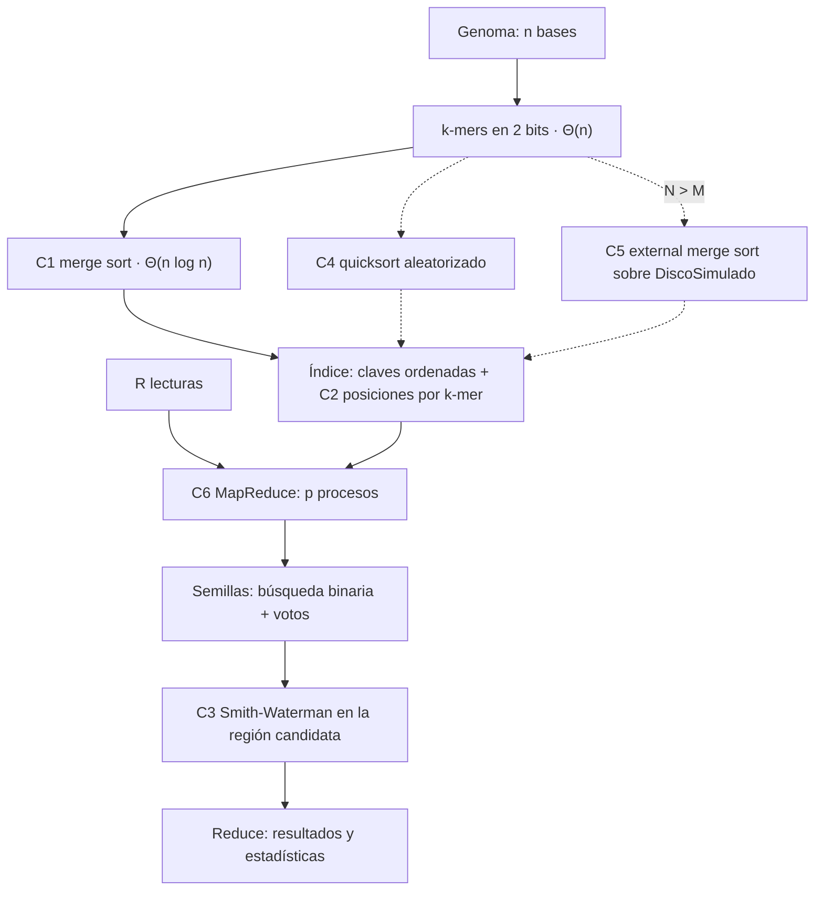
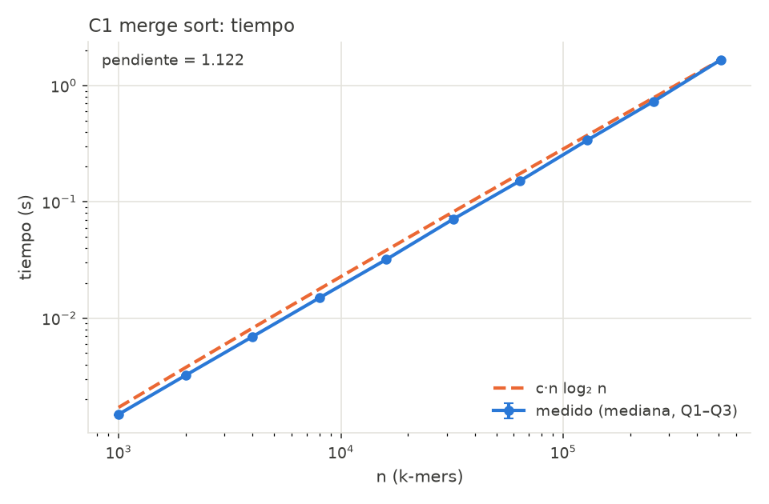
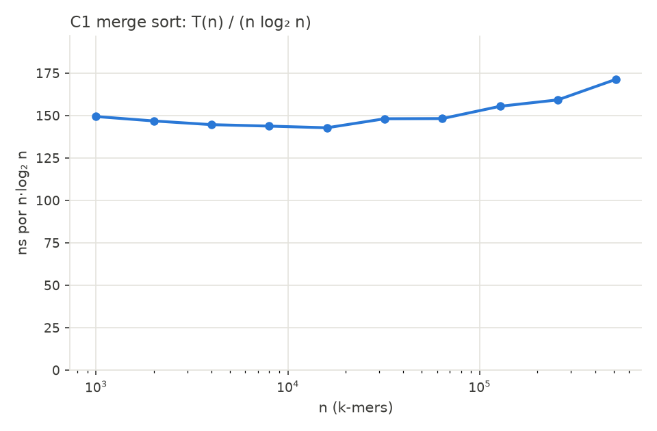
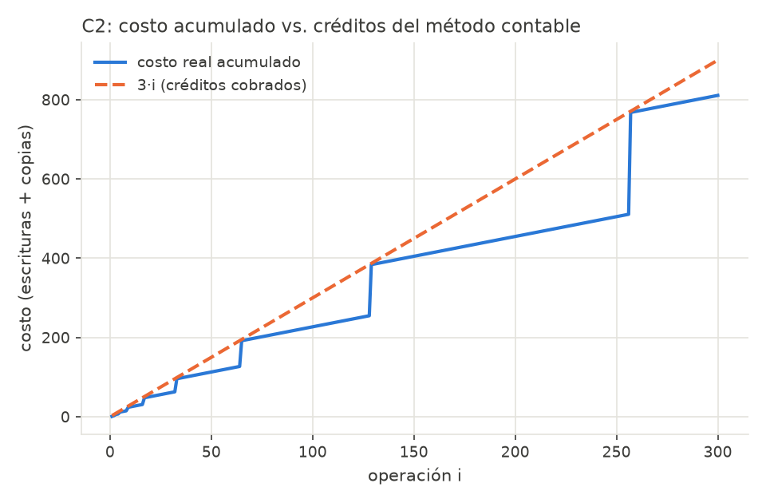
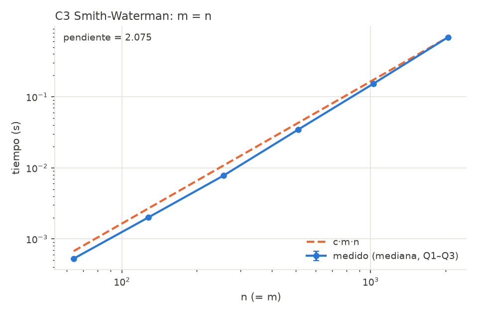
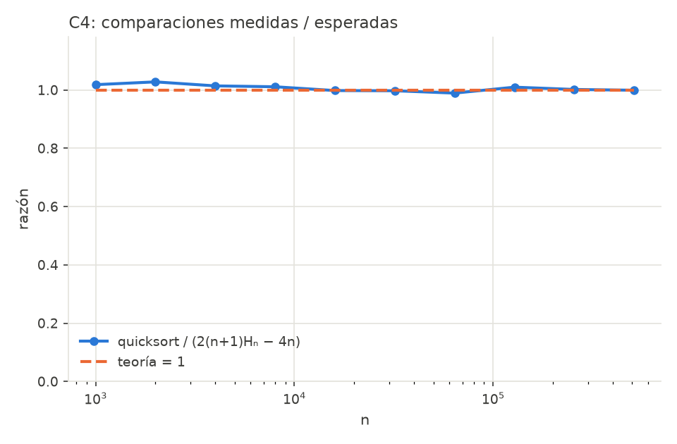
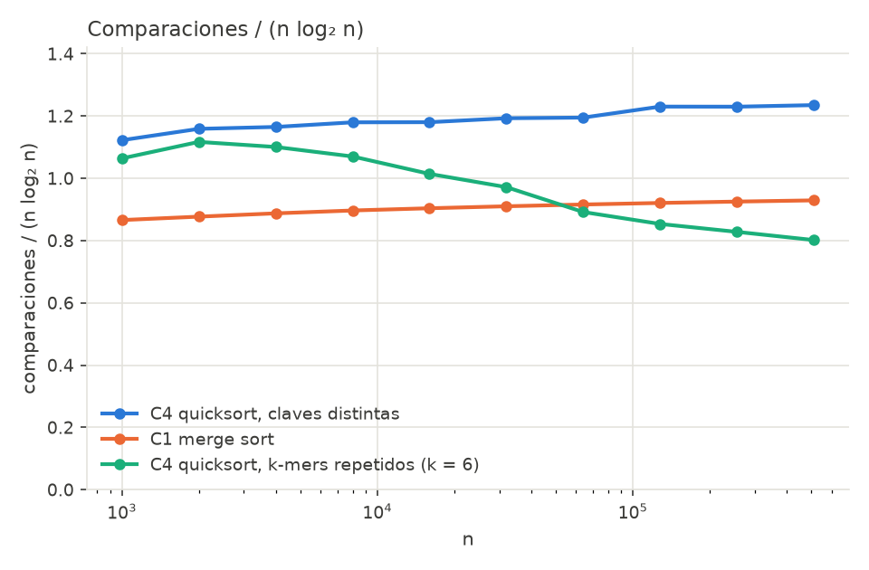
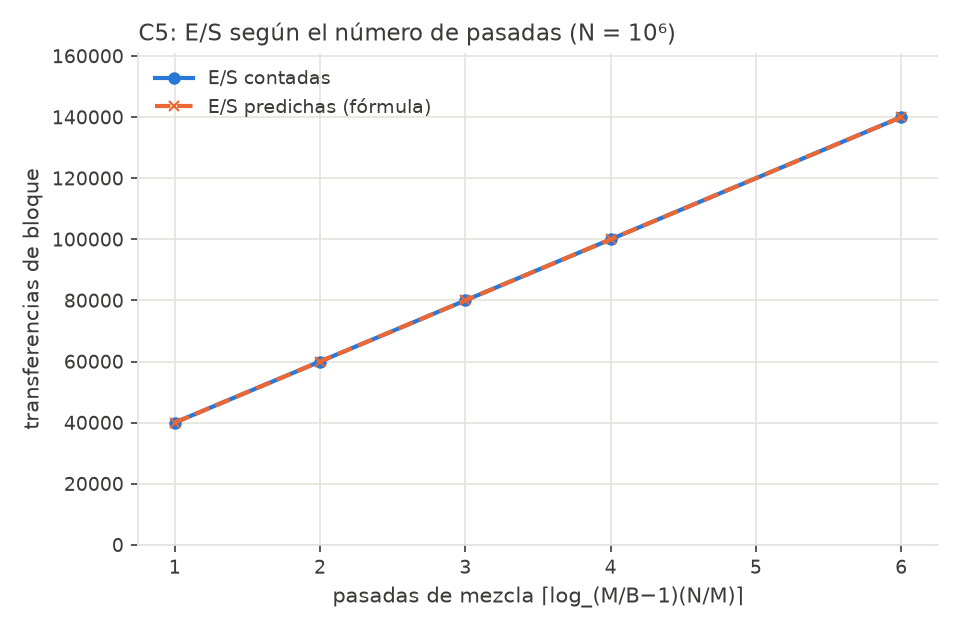
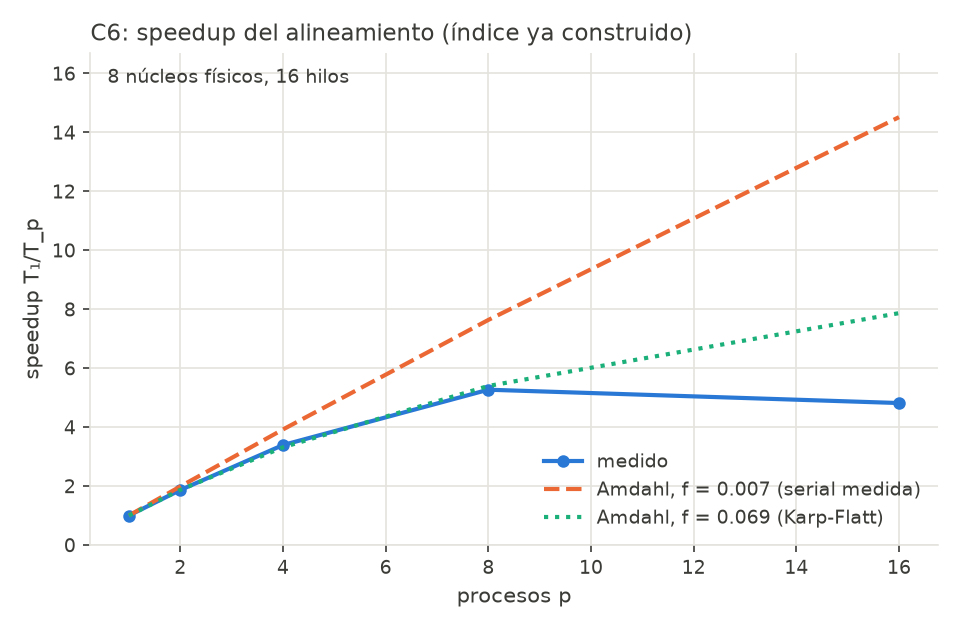

# Alineamiento de lecturas genómicas con k-mers como semillas

**Informe técnico: Proyecto Final Integrador, Análisis de Algoritmos (SIST0175), Grupo 3**

Kuilmer Santiago Hernández Cruz · Juan José Berrio Español · Santiago Serrano Cuellar

## 1. Descripción del caso

**Problema.** Dado un genoma de referencia G de n bases sobre Σ = {A, C, G, T} y un conjunto de R lecturas cortas (m = 50 bases) copiadas de G con errores, se quiere encontrar para cada lectura la posición de G de la que proviene y su alineamiento. Las lecturas tienen sustituciones, inserciones y borrados. Comparar cada lectura contra todo G por programación dinámica cuesta Θ(m·n) por lectura, prohibitivo para n = 10⁶. La estrategia estándar, *seed and extend*, es indexar los k-mers de G, usar los k-mers de la lectura como **semillas** para encontrar una región candidata pequeña y alinear solo contra esa región.

**Supuestos.**
- Genoma uniforme e independiente (sin repeticiones biológicas).
- Las lecturas provienen de la hebra directa.
- k ≤ 31, para que un k-mer quepa en 64 bits.
- Puntajes lineales: +2 coincidencia, −1 sustitución, −2 hueco.

**Generador** (`datos/generar.py`, semilla fija):
- **Genoma:** n bases uniformes.
- **Lecturas:** de largo 50, en posiciones uniformes, con sustituciones (2 %) e indels (0–2 %). Cada lectura guarda su posición real, lo que permite medir la exactitud.
- **k-mers:** se extraen codificados en 2 bits por base (A=0, C=1, G=2, T=3) con una ventana deslizante en Θ(n). El orden entero coincide con el lexicográfico y comparar cuesta O(1).

## 2. Arquitectura



- **Índice** (`comun/indice.py`): se ordenan los pares (kmer, posición) con C1 (o C4), y por cada k-mer distinto se guarda un arreglo dinámico (C2) con sus posiciones. Una consulta es una búsqueda binaria en Θ(log u), con u = número de k-mers distintos.
- **Alineador** (`comun/alineador.py`): cada semilla encontrada en la posición p, con desplazamiento o dentro de la lectura, vota por el inicio p − o. Se alinea con C3 contra la región más votada (m + 2·10 bases).
- **C5** construye el mismo arreglo ordenado cuando N > M, sobre el disco simulado.
- **C6** reparte las lecturas entre procesos.

---

## 3. Análisis teórico

El desarrollo completo de C1–C3 (pruebas y tablas de casos) está en el anexo A (`docs/analisis_teorico_c1_c3.md`). Aquí se resume.

### C1. Merge sort (divide y vencerás)

**Recurrencia leída del código.** Dos llamadas sobre ⌊n/2⌋ y ⌈n/2⌉ elementos, más la copia de las mitades y la mezcla, ambas Θ(n):

```
T(n) = 2T(n/2) + Θ(n)
```

**Teorema Maestro:** a = 2, b = 2, f(n) = n = Θ(n^(log_b a)). Es el caso 2, así que T(n) = Θ(n log n).

**Casos** (tiempo Θ(n log n) en los tres):

| Caso | Entrada | Comparaciones |
|---|---|---|
| Mejor | ordenada | (n/2)·log₂ n |
| Peor | mitades intercaladas | n log₂ n − n + 1 |
| Esperado | permutación aleatoria | ≈ n log₂ n − 1,25n |

- Memoria extra: Θ(n). Es estable.

**Cota inferior.** Un árbol de decisión que ordena n claves distintas tiene ≥ n! hojas. Si su altura es h, entonces 2ʰ ≥ n!, así que h ≥ log₂ n! ≥ (n/2)·log₂(n/2) = Ω(n log n). Merge sort es óptimo salvo términos de orden n. La cota también vale en promedio, pero no para toda entrada: con la entrada ordenada, merge sort hace menos que log₂ n! comparaciones.

### C2. Arreglo dinámico con duplicación (método contable)

- **Costo real:** 1 por escritura y 1 por cada elemento copiado al duplicar.
- **Créditos:** se cobran ĉ = 3 por `agregar`. Uno paga la escritura y dos se depositan sobre el elemento.
- **Invariante:** al duplicar de c a 2c hay que copiar c elementos, y los c/2 insertados desde la duplicación anterior guardan 2·(c/2) = c créditos. Por inducción, el saldo nunca es negativo.
- **Conclusión:** costo real de n operaciones ≤ 3n, es decir O(1) amortizado por `agregar`. El peor caso de una sola operación es Θ(n).
- **Valor exacto:** n + 2^⌈log₂ n⌉ − 1 < 3n. La razón costo/n se acerca a 3 en n = 2ʲ + 1.
- **En el código:** el saldo se instrumenta (`saldo`, `saldo_minimo`).

### C3. Smith-Waterman (programación dinámica)

H[i][j] es el mejor puntaje de un alineamiento local que termina en aᵢ₋₁ y bⱼ₋₁:

```
H[i][j] = max(0, H[i−1][j−1] + s(aᵢ₋₁, bⱼ₋₁), H[i−1][j] − 2, H[i][j−1] − 2)
H[i][0] = H[0][j] = 0;  respuesta: el máximo de H en toda la tabla
```

- **Subestructura óptima:** se demuestra cortando la última columna del alineamiento (argumento de cortar y pegar).
- **Subproblemas superpuestos:** la recursión ingenua hace ≥ 3^min(m,n) llamadas, pero solo hay (m+1)(n+1) subproblemas distintos.
- **Tabla:** se llena por filas; el retroceso hasta el primer 0 reconstruye el alineamiento.
- **Complejidad:** tiempo Θ(mn) en todos los casos (la tabla siempre se llena completa). Memoria Θ(mn); si solo se quiere el puntaje bastan dos filas, Θ(n) (`puntaje_dos_filas`), pero sin la tabla no hay retroceso. Retroceso O(m + n).
- **En el sistema:** alinear contra la región candidata cuesta Θ(m(m+20)) en vez de Θ(mn).

### C4. Quicksort aleatorizado con partición de 3 vías

- **Algoritmo:** se elige un pivote uniforme y se particiona en < = > (invariante de Dijkstra). Hay recursión solo sobre la zona menor y un ciclo sobre la mayor, así que la pila es O(log n) en el peor caso.
- **Caso esperado:** sean z₁ < … < zₙ. zᵢ y zⱼ se comparan si y solo si el primer pivote elegido de {zᵢ, …, zⱼ} es zᵢ o zⱼ, lo que ocurre con probabilidad 2/(j − i + 1). Por linealidad de la esperanza:

```
E[C] = Σ_{i<j} 2/(j−i+1) = 2(n+1)Hₙ − 4n ≈ 2n ln n ≈ 1,39·n log₂ n
```

- La esperanza es sobre los pivotes, así que vale para **toda** entrada.
- **Peor caso** Θ(n²): requiere elegir siempre un extremo como pivote, con probabilidad ≤ 2^(n−1)/n!.
- **Mejor caso** Θ(n log n). Si todas las claves son iguales, la partición de 3 vías termina en Θ(n): una sola pasada.
- **Con u claves distintas:** el costo esperado es O(n log u).
- **Frente a C1:** hace ≈ 50 % más comparaciones, pero ordena en su lugar (memoria O(log n)). Por eso se usa en la fase 1 de C5.

### C5. External merge sort (modelo de memoria externa)

- **Parámetros:** N registros, M en memoria, bloques de B. El costo es el número de transferencias de bloque.
- **Fase 1:** lee M registros, los ordena (con C4) y escribe la corrida. Produce ⌈N/M⌉ corridas con 2N/B E/S.
- **Fase 2:** mezcla k = M/B − 1 corridas por grupo, con k búferes de entrada más uno de salida, que suman exactamente M/B bloques. El mínimo entre las k cabezas sale de un min-heap propio en O(log k). Cada pasada divide las corridas por k y cuesta 2N/B E/S. Por tanto:

```
E/S = 2·(N/B)·(1 + ⌈log_{M/B−1}(N/M)⌉)
```

- **Exactitud:** las corridas son rangos contiguos alineados a bloques (M es múltiplo de B). Si B divide a N la igualdad es exacta; si no, la diferencia es el último bloque incompleto.
- **Tiempo de CPU:** Θ(N log M) esperado en la fase 1 más Θ(N log k) por pasada.
- **Memoria:** la memoria interna se instrumenta y la ejecución falla si supera M registros.

### C6. MapReduce con multiprocessing

- **Esquema:** construir el índice (serial) → partir las R lecturas en 4p bloques → **map** (p procesos `fork` heredan el índice sin copiarlo) → **reduce** (concatenar en orden y calcular estadísticas, Θ(R)).
- **Costo de una lectura:** c_L = Θ(m log n + m(m + 20)).

**Trabajo y profundidad:**

```
W = Θ(n log n) + R·c_L + Θ(R)        D = Θ(n log n) + c_L + Θ(R)
```

- **Brent:** T_p ≤ W/p + D.
- **Comunicación:** Θ(R·m) bytes hacia los procesos y Θ(R) de vuelta.
- **Ley de Amdahl:** si f es la fracción serial del tiempo secuencial, S(p) = 1/(f + (1−f)/p) ≤ 1/f. La fase serial dominante es el índice (Θ(n log n)), así que se distinguen dos escenarios: alineamiento con el índice ya construido (f pequeña) y sistema completo (f grande).

---

## 4. Validación empírica

**Protocolo** (`experimentos/bench.py`):
- `time.perf_counter()`, 5 repeticiones por punto, mediana con barra Q1–Q3;
- datos generados fuera del tiempo medido y recolector de basura desactivado al medir;
- pendiente por mínimos cuadrados en log-log;
- ≥ 5 tamaños en progresión geométrica.
- **Máquina:** AMD Ryzen 7 3800XT (8 núcleos, 16 hilos), 16 GB de RAM, Python 3.11.

**Referencia para n log n.** En log-log, n log n no es una recta. Su pendiente ajustada en el rango 10³–5·10⁵ es 1,10, y esa es la referencia, no 1.

| Hipótesis | Medido | Predicho | Veredicto |
|---|---|---|---|
| H1 C1: T = Θ(n log n) | pendiente 1,12; T/(n log₂ n) = 143–171 ns | 1,10; constante | ✓ |
| H1 C1: log₂ n! ≤ C ≤ n log₂ n | C/(n log₂ n) = 0,866 → 0,929 | → 1 − 1,25/log₂ n (0,934) | ✓ |
| H1 C1: mejor y peor caso, n = 2¹⁰…2²⁰ | igual a (n/2) log₂ n y n log₂ n − n + 1 en los 11 tamaños; tiempo: pendientes 1,07 / 1,10 / 1,10 (mejor / peor / aleatoria) | igualdad; ≈ 1,1 | ✓ |
| Memoria C1 vs. C4 (tracemalloc) | merge sort 17 B extra por elemento (pendiente 1,01); quicksort ≈ 2,6 KB fijos | Θ(n); O(log n) | ✓ |
| Memoria C3: tabla vs. dos filas | 8,2 B por celda (13 MB con n = 32 000); dos filas 16 B por columna | Θ(mn); Θ(n) | ✓ |
| H2 C2: costo < 3n, saldo ≥ 0 | costo/n = 2,02 (n = 1000·2ⁱ); 2,997–3,000 (n = 2ʲ + 1); saldo mín. 0 | < 3; ≥ 0 | ✓ |
| H2 C2: T = Θ(n) | pendiente 1,01 | 1 | ✓ |
| H3 C3: T = Θ(mn) | pendiente 1,02 (m = 50); 2,08 (m = n) | 1; 2 | ✓ |
| H4 C4: C / (2(n+1)Hₙ − 4n) → 1 | 0,989–1,028 (claves distintas); 0,977–1,036 (entrada ordenada) | 1 | ✓ |
| H4 C4: T = Θ(n log n) | pendiente 1,14 (C1: 1,13 en la misma corrida) | 1,10 | ✓ |
| H5 C5: E/S contadas = fórmula | igualdad exacta en 10/10 configuraciones (1 a 6 pasadas); pico de memoria = M | igualdad | ✓ |
| H6a C6: T₁ = Θ(R) | pendiente 1,01; 0,57 ms por lectura | 1 | ✓ |
| H6b C6: Amdahl con f medida | S(8) = 5,27 frente a 7,64 predicho | ±15 % | ✗ (ver §5) |
| H6b C6: sistema completo | S(8) = 2,18 frente a 2,38; cota 1/f = 2,97 | ±15 % | ✓ |

{width=55%}

{width=55%}

{width=55%}

{width=55%}

**C4.** Comparaciones medidas, promediadas sobre 5 semillas de pivote:

- **Claves distintas:** 0,99–1,03 veces el valor esperado exacto, sin tendencia. Con la entrada ya ordenada el valor es el mismo: el pivote aleatorio elimina el peor caso sistemático.
- **Frente a merge sort:** C/(n log₂ n) es ≈ 1,23 para quicksort y ≈ 0,93 para merge sort. El 1,39 de 2n ln n solo se alcanza asintóticamente; en n = 5·10⁵ el término −4n todavía pesa.
- **Con k-mers repetidos** (k = 6, u ≤ 4096): la razón **baja** de 1,06 a 0,80 al crecer n, como predice O(n log u).
- **Tiempo:** quicksort tarda lo mismo que merge sort hasta n ≈ 3·10⁴ y luego entre 6 y 11 % más (hace ≈ 33 % más comparaciones). La diferencia de tiempo es menor que la de comparaciones porque en Python cada paso pesa más por el trabajo del intérprete (intercambios, índices, contadores) que por la comparación misma.

{width=55%}

{width=55%}

**C5.** Registros de 12 bytes con B = 100.

| N | M | k = M/B − 1 | corridas | pasadas | E/S contadas | E/S predichas | pico memoria |
|---|---|---|---|---|---|---|---|
| 100 000 | 5 000 | 49 | 20 | 1 | 4 000 | 4 000 | 5 000 |
| 177 800 | 8 800 | 87 | 21 | 1 | 7 112 | 7 112 | 8 800 |
| 316 200 | 15 800 | 157 | 21 | 1 | 12 648 | 12 648 | 15 800 |
| 562 300 | 28 100 | 280 | 21 | 1 | 22 492 | 22 492 | 28 100 |
| 1 000 000 | 50 000 | 499 | 20 | 1 | 40 000 | 40 000 | 50 000 |
| 1 000 000 | 10 000 | 99 | 100 | 2 | 60 000 | 60 000 | 10 000 |
| 1 000 000 | 2 000 | 19 | 500 | 3 | 80 000 | 80 000 | 2 000 |
| 1 000 000 | 1 000 | 9 | 1 000 | 4 | 100 000 | 100 000 | 1 000 |
| 1 000 000 | 500 | 4 | 2 000 | 6 | 140 000 | 140 000 | 500 |

- Las cinco primeras filas usan M = N/20, lo máximo permitido. En ese régimen una pasada de mezcla siempre alcanza: N/M = 20 ≤ k.
- Las cinco últimas fijan N = 10⁶ y reducen M para forzar más pasadas. Cada pasada adicional suma exactamente 2N/B = 20 000 E/S.
- **Tiempo:** pendiente 1,09 con M = N/20, coherente con Θ(N log M).
- Los tests cubren además N no múltiplo de B: la única diferencia con la fórmula es el último bloque incompleto, menos del 1 %.

{width=55%}

**C6.** Genoma de 10⁶ bases y R = 16 000 lecturas.

- Construir el índice (serial) tarda 4,5 s y el alineamiento con p = 1 tarda 9,3 s.
- **Fracción serial medida directamente** (arranque y cierre de procesos + reduce): f = 0,007 en el alineamiento y f = 0,34 en el sistema completo.

| p | 1 | 2 | 4 | 8 | 16 |
|---|---|---|---|---|---|
| S medido (alineamiento) | 1,00 | 1,86 | 3,39 | 5,27 | 4,82 |
| Amdahl, f = 0,007 medida | 1,00 | 1,99 | 3,92 | 7,64 | 14,52 |
| Karp-Flatt e(p) | | 0,073 | 0,060 | 0,074 | 0,155 |
| Amdahl, f = 0,069 (Karp-Flatt) | 1,00 | 1,87 | 3,31 | 5,40 | 7,87 |
| S medido (sistema completo) | 1,00 | 1,45 | 1,89 | 2,18 | 2,12 |
| Amdahl, f = 0,34 medida | 1,00 | 1,50 | 1,99 | 2,38 | 2,64 |

{width=55%}

---

## 5. Discusión

**Dónde coinciden teoría y práctica.**
- **Pendientes:** en las seis hipótesis de complejidad (C1, C2, C3a, C3b, C4 y C6a) coinciden con la predicción con error ≤ 0,08.
- **Conteos exactos:** las cantidades que dependen solo del algoritmo coinciden **exactamente** o dentro de la variación aleatoria:
  - comparaciones de C1 y C4;
  - costo del arreglo dinámico;
  - celdas de Smith-Waterman (= m·n);
  - E/S de C5.
- Esto confirma que el análisis predice el **conteo de operaciones**. Lo que no predice son los segundos.

**Dónde no coinciden y por qué.**
1. **Constantes del intérprete.** Una comparación o una celda cuesta ≈ 140 ns, unas 100 veces más que en C. Las constantes cambian, pero no los exponentes.
2. **Caché y memoria.** T/(n log n) de C1 sube ≈ 13 % para n ≥ 10⁵, y el costo por celda de Smith-Waterman con m = n sube de 119 a 165 ns. Las comparaciones por elemento no cambian, así que no es un efecto algorítmico: las listas de Python (punteros a objetos dispersos en el heap) dejan de caber en caché. Esto también explica la pendiente 2,08 en vez de 2,00.
3. **Quicksort frente a merge sort.** La teoría (≈ 33 % más comparaciones) y la práctica (hasta 11 % más lento) concuerdan en Python. En C, quicksort suele ganar por localidad de caché, una ventaja que el intérprete diluye.
4. **Amdahl con la fracción serial medida subestima el sobrecosto paralelo.** La métrica de Karp-Flatt da e(p) ≈ 0,07 casi constante en p = 2, 4, 8: el sobrecosto se comporta como una parte serial fija de ≈ 0,6 s, unas 10 veces la medida.
   - **Explicación más probable:** *copy-on-write*. Los procesos hijos heredan el índice (≈ 10⁶ objetos de Python) por `fork`, pero el conteo de referencias de Python **escribe** en cada objeto que se lee. Cada hijo termina copiando las páginas del índice que toca. Todos lo hacen en paralelo, así que en tiempo real ese costo no se divide entre p.
   - **Con p = 16** e(p) salta a 0,155: los 16 hilos son 8 núcleos físicos con SMT, que comparten unidades de cómputo y caché. Pasar de 8 a 16 procesos no agrega potencia y suma contención.
   - **Mejora posible:** un índice en arreglos contiguos (`array`/NumPy) en memoria compartida, que no tiene contadores de referencia por elemento.
5. **La ley de Amdahl sí explica el sistema completo.** La construcción serial del índice (Θ(n log n)) fija f = 0,34 y una cota de speedup de 1/f ≈ 3, que se observa con S(8) = 2,18. Para escalar habría que paralelizar también la construcción del índice. Por ejemplo, con un ordenamiento por partes, como las corridas de C5, mezcladas al final.

## 6. Conclusiones y reparto del trabajo

- **Los seis componentes funcionan e integran un sistema completo.** Con un genoma de 10⁶ bases, el sistema ubica las lecturas con errores (2 % de sustituciones, 1 % de indels) a ≤ 3 bases de su posición real. Hay 134 pruebas automáticas, con `sorted` solo como oráculo.
- **Cada afirmación de complejidad está respaldada por una prueba y por un experimento.** Las predicciones de conteo (comparaciones, créditos, celdas, E/S) se cumplen exactamente o dentro de la variación aleatoria, y las pendientes log-log coinciden con la teoría.
- **El único desacuerdo relevante, el speedup de C6, también se explica:** la métrica de Karp-Flatt identifica un sobrecosto que se comporta como fracción serial, y la ley de Amdahl aplicada al sistema completo muestra que la construcción serial del índice es el cuello de botella.
- **Lección general:** el análisis asintótico predice **cómo crece** el costo y el **número de operaciones**. Los segundos dependen además de la jerarquía de memoria, el intérprete y el hardware.

**Reparto del trabajo.** Cada integrante tuvo dos componentes con un hilo común, y los tres revisaron y pueden explicar los seis.

| Integrante | Componentes | Otras tareas |
|---|---|---|
| Santiago Serrano Cuellar | **C1** merge sort y cota inferior; **C4** quicksort aleatorizado y su comparación con C1 (ordenamiento en memoria) | Generador de datos y codificación de k-mers; harness de medición (`bench.py`); organización del repositorio y README; secciones 1, 2 y 4 del informe |
| Juan José Berrio Español | **C2** arreglo dinámico y método contable; **C5** ordenamiento externo (estructuras y memoria secundaria) | `DiscoSimulado`, min-heap e índice de semillas; tabla de E/S contadas frente a predichas; teoría de C2 y C5 en el informe |
| Kuilmer Santiago Hernández Cruz | **C3** Smith-Waterman; **C6** MapReduce (alineamiento y su paralelización) | Alineador por votos de semillas; experimento de speedup, Amdahl y Karp-Flatt; teoría de C3 y C6 y sección 5 (discusión) del informe |

## 7. Referencias

1. T. H. Cormen, C. E. Leiserson, R. L. Rivest y C. Stein. *Introduction to Algorithms*, 4.ª ed. MIT Press, 2022. Caps. 2 y 4 (merge sort, Teorema Maestro), 7 (quicksort aleatorizado), 8 (cota inferior), 14 (programación dinámica), 16 (análisis amortizado).
2. T. F. Smith y M. S. Waterman. "Identification of common molecular subsequences". *Journal of Molecular Biology* 147(1):195–197, 1981.
3. A. Aggarwal y J. S. Vitter. "The input/output complexity of sorting and related problems". *Communications of the ACM* 31(9):1116–1127, 1988.
4. C. A. R. Hoare. "Quicksort". *The Computer Journal* 5(1):10–16, 1962.
5. J. L. Bentley y M. D. McIlroy. "Engineering a sort function". *Software: Practice and Experience* 23(11):1249–1265, 1993.
6. G. M. Amdahl. "Validity of the single processor approach to achieving large scale computing capabilities". *AFIPS Conference Proceedings* 30:483–485, 1967.
7. J. Dean y S. Ghemawat. "MapReduce: Simplified data processing on large clusters". *OSDI*, 2004.
8. R. P. Brent. "The parallel evaluation of general arithmetic expressions". *Journal of the ACM* 21(2):201–206, 1974.
9. Python Software Foundation. *multiprocessing: Process-based parallelism*. Documentación de Python 3.11.

**Declaración de uso de IA.** Se usó un asistente de IA (Claude) para apoyar el diseño, la organización del repositorio, la redacción y la depuración. El equipo revisó todo el código y el análisis.

## Anexos

- **A.** Análisis teórico detallado de C1–C3 (`docs/analisis_teorico_c1_c3.md`).
- **B.** Plan de experimentos y resultados por punto (`docs/plan_experimentos.md`, `experimentos/resultados/*.csv`; casos extremos y memoria en `experimentos/exp_casos_y_memoria.py`).
