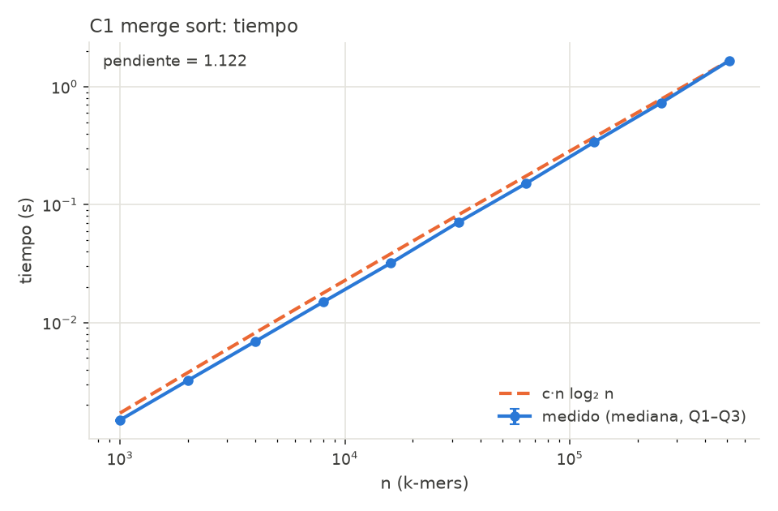
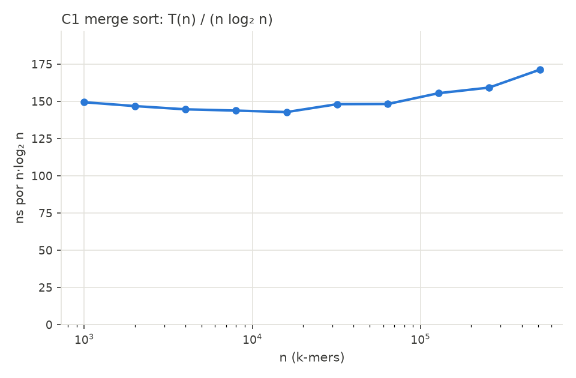
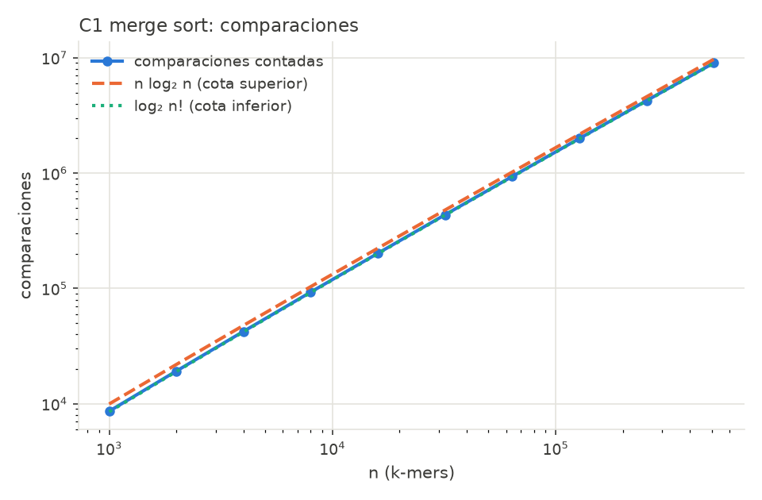
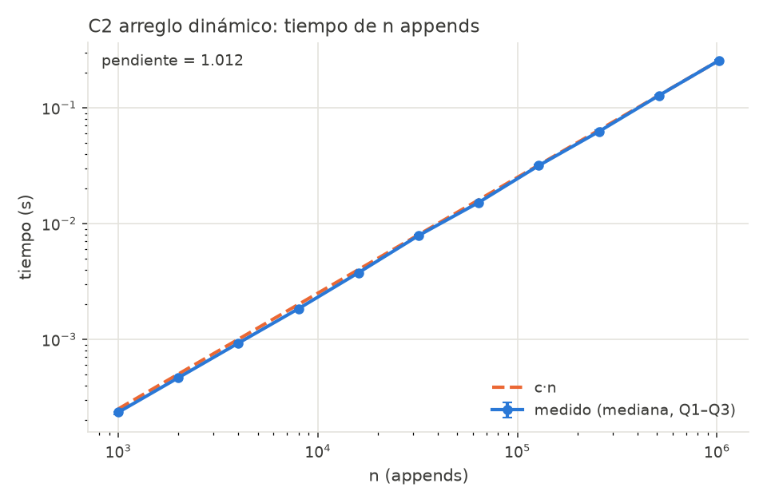
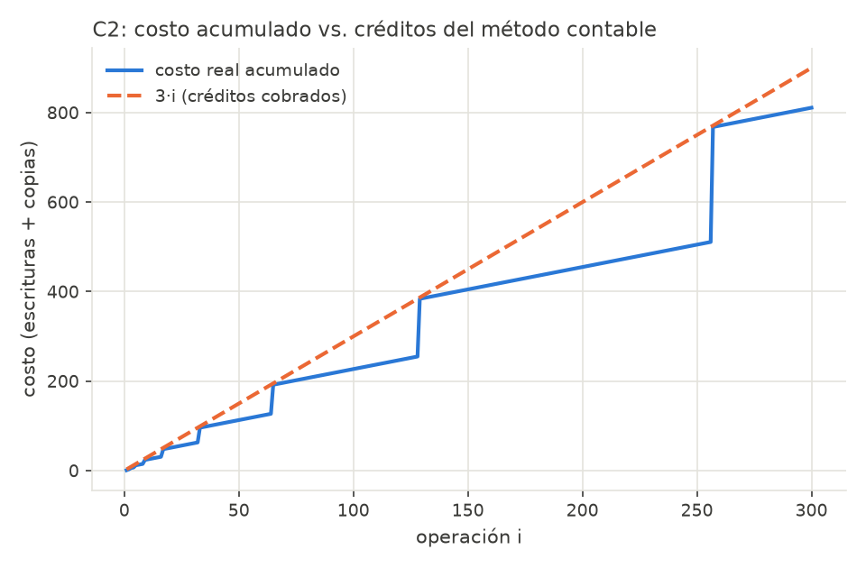
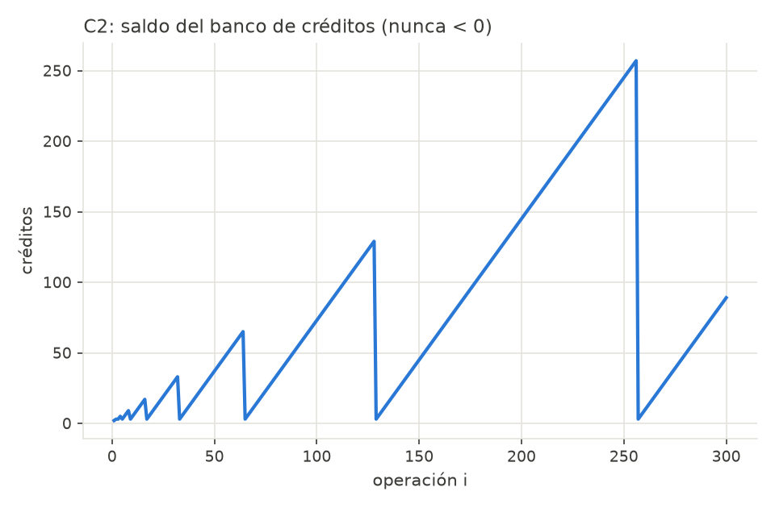
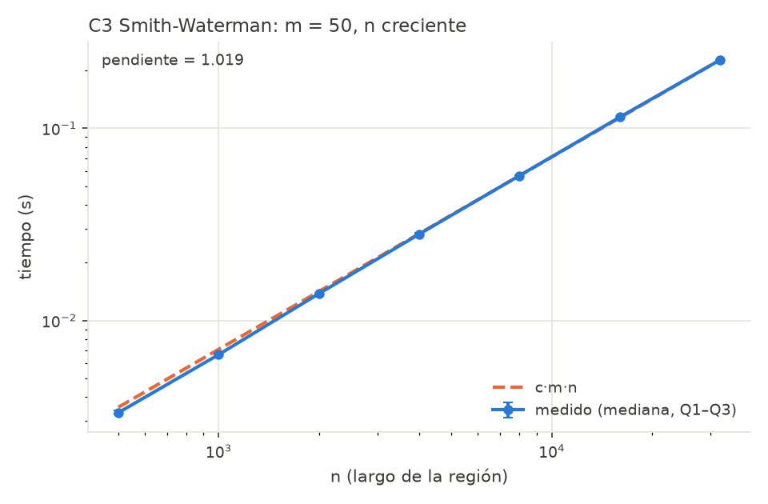
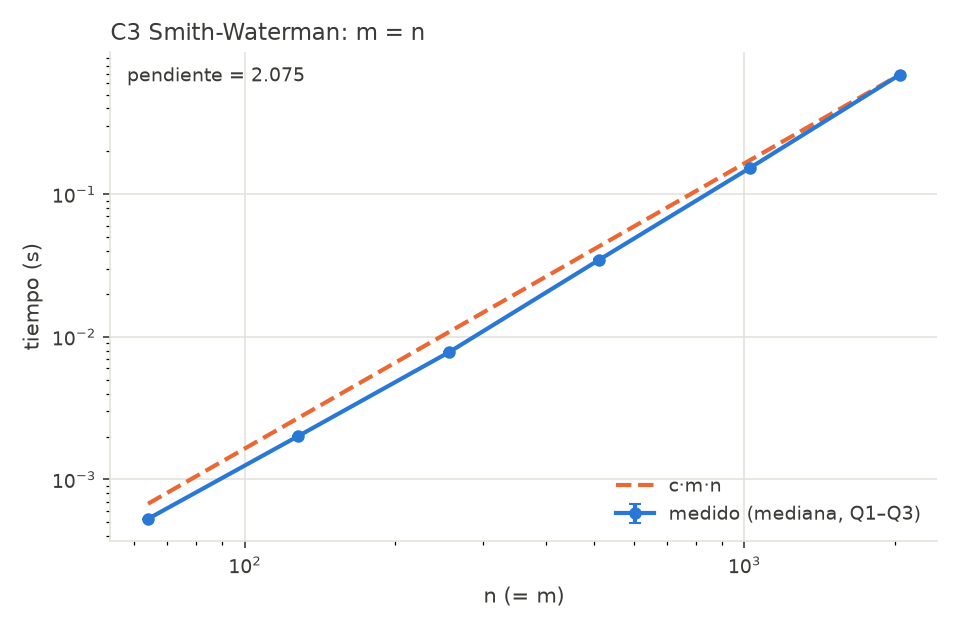
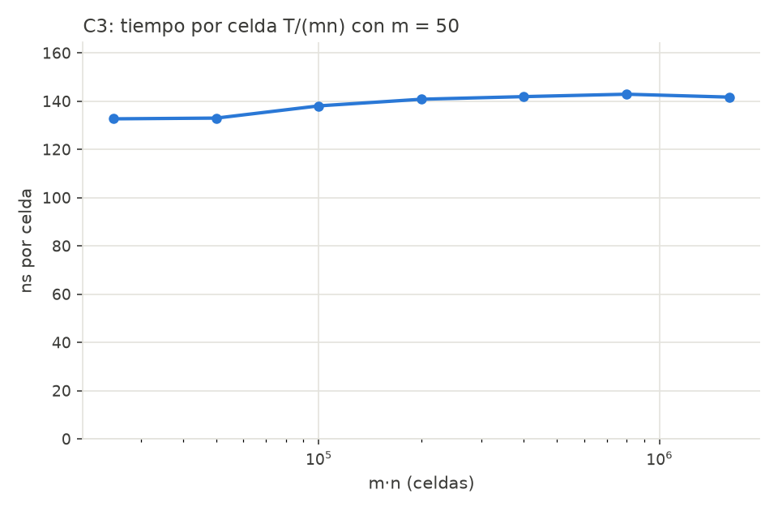

# Plan de experimentos: avance de la sesión 2

Grupo 3: alineamiento de lecturas genómicas.

Para cada componente se fija una **hipótesis explícita**, derivada del análisis teórico ([analisis_teorico_c1_c3.md](analisis_teorico_c1_c3.md)), junto con el experimento que la pone a prueba y el **criterio con que se acepta o se rechaza**. Los experimentos de C1 a C3 ya están implementados y ejecutados; los resultados preliminares están en la sección 3.

## 1. Protocolo común

Lo implementa el harness [experimentos/bench.py](../experimentos/bench.py).

| Regla (enunciado §4.3) | Cómo se cumple |
|---|---|
| `time.perf_counter()`, ≥ 5 repeticiones, mediana y dispersión | `medir()` repite 5 veces; `resumen()` reporta mediana, Q1, Q3, mínimo y máximo. Las gráficas muestran la mediana con una barra Q1–Q3 |
| Generación de datos fuera del tiempo medido | `medir(funcion, preparar)`: `preparar()` arma los datos antes de arrancar el cronómetro |
| Log-log y pendiente estimada | `pendiente_loglog()`: ajuste por mínimos cuadrados de log T = p·log n + b |
| Para n log n, graficar T(n)/(n log n) | Gráficas `*_razon_*`, con el eje Y desde 0 para no exagerar la variación |
| ≥ 5 tamaños en progresión geométrica | n se duplica: entre 6 y 11 tamaños por experimento |
| Datos con semilla fija | [datos/generar.py](../datos/generar.py): `random.Random(semilla)` |

**Control de ruido:**
- El recolector de basura se apaga durante cada medición.
- Los experimentos se corren uno a la vez, nunca en paralelo, para que no compitan por la CPU.
- Cada script guarda su CSV en `experimentos/resultados/` y sus PNG en `experimentos/graficas/`.

**Cómo leer la pendiente de n log n.** En log-log, n log n **no** es una recta. Su pendiente local es 1 + 1/ln n. Si se ajusta una recta a c·n·log₂ n sobre el mismo rango que medimos (n = 10³ … 5,12·10⁵), la pendiente esperada es **≈ 1,10**, no 1. Esa es la referencia contra la que se compara C1.

**Reproducir** (desde la raíz del repo):

```
python -m experimentos.exp_c1_mergesort
python -m experimentos.exp_c2_arreglo_dinamico
python -m experimentos.exp_c3_smith_waterman
```

## 2. Hipótesis por componente

### H1: C1 merge sort

- **Hipótesis:** T(n) = Θ(n log n). El número de comparaciones C(n) cumple log₂ n! ≤ C(n) ≤ n log₂ n − n + 1. En entradas aleatorias, C(n) ≈ n log₂ n − 1,25n.
- **Datos:** n k-mers (k = 15) codificados en 2 bits, extraídos de un genoma de semilla 42. n = 1000·2ⁱ para i = 0…9, es decir de 10³ a 5,12·10⁵ (10 tamaños).
- **Mediciones:** tiempo (mediana y Q1–Q3), comparaciones contadas, T/(n log₂ n), C/(n log₂ n).
- **Criterio de aceptación:**
  - la pendiente log-log está en [1,05; 1,20];
  - T/(n log₂ n) varía menos de ±20 % alrededor de su media;
  - las comparaciones quedan dentro de las dos cotas en todos los tamaños.
- **Para la entrega final:**
  - llegar a n = 10⁶;
  - medir el mejor caso (entrada ordenada, C = (n/2) log₂ n) y el peor (entrada intercalada, C = n log₂ n − n + 1);
  - medir memoria con `tracemalloc`.

### H2: C2 arreglo dinámico

- **Hipótesis:**
  - el costo real de n appends (escrituras + copias) es < 3n, y el saldo de créditos nunca es negativo;
  - el tiempo total es Θ(n): pendiente log-log ≈ 1 y tiempo por append aproximadamente constante;
  - la razón costo/n oscila entre ≈ 2 (justo antes de duplicar) y ≈ 3 (justo después, n = 2ʲ + 1).
- **Datos:** n = 1000·2ⁱ para i = 0…10, es decir de 10³ a 1,024·10⁶ (11 tamaños). Además, n = 2ʲ + 1 para observar el peor caso de la razón.
- **Mediciones:** tiempo, costo acumulado, costo/n, `saldo_minimo`. También el costo acumulado operación por operación para i ≤ 300 (gráfica en "dientes de sierra" contra la recta 3i).
- **Criterio de aceptación:**
  - la pendiente está en [0,95; 1,05];
  - costo/n < 3 en todos los tamaños;
  - `saldo_minimo` = 0 (nunca negativo).

### H3: C3 Smith-Waterman

- **Hipótesis:** T(m, n) = Θ(mn), independiente del contenido de las cadenas.
- **Datos:** cadenas de semillas 1 y 2.
  - (a) Lectura fija m = 50 y región n = 500·2ⁱ, de 500 a 32 000 (7 tamaños): es el caso real del pipeline.
  - (b) Cuadrado m = n = 64·2ⁱ, de 64 a 2048 (6 tamaños).
- **Mediciones:** tiempo, T/(mn) en ns por celda, celdas calculadas (deben ser exactamente m·n).
- **Criterio de aceptación:**
  - pendiente (a) en [0,95; 1,05];
  - pendiente (b) en [1,90; 2,10];
  - T/(mn) varía menos de ±20 % en el caso (a).
- **Para la entrega final:**
  - medir memoria: Θ(mn) con la tabla completa frente a Θ(n) con la versión de dos filas;
  - comparar el costo de alinear contra la región candidata con el de alinear contra el genoma completo.

### H4: C4 quicksort aleatorizado (sesión 3)

- **Hipótesis:**
  - con claves distintas, E[comparaciones] = 2(n+1)H_n − 4n ≈ 2n ln n ≈ 1,39·n log₂ n;
  - con partición de 3 vías y muchos k-mers repetidos, el número de comparaciones baja;
  - la varianza entre repeticiones es pequeña: el pivote aleatorio evita depender del orden de la entrada.
- **Datos:** los mismos tamaños que H1, con dos variantes:
  - pares (kmer, posición), donde todas las claves son distintas;
  - solo kmers con k pequeño (k = 6, máximo 4096 claves distintas), con muchos duplicados.
  - Además, entrada ya ordenada: el pivote aleatorio mantiene Θ(n log n) donde un quicksort con pivote fijo sería Θ(n²).
- **Mediciones:** comparaciones/(n ln n) (debe tender a 2), tiempo frente a C1 sobre los mismos datos y en la misma máquina, dispersión entre semillas.
- **Criterio de aceptación:**
  - comparaciones/(2n ln n) en [0,85; 1,05];
  - quicksort hace más comparaciones que merge sort (≈ 1,39 frente a ≈ 0,93 veces n log₂ n), y se discute por qué aun así puede ser más rápido o más lento en Python.

### H5: C5 external merge sort sobre `DiscoSimulado` (sesión 3)

- **Hipótesis:** las E/S **contadas** por `DiscoSimulado` coinciden con las predichas:
  E/S = 2·(N/B)·(1 + ⌈log_(M/B − 1)(N/M)⌉).
  - El 1 corresponde a la fase de crear las corridas iniciales ordenadas de tamaño M.
  - El logaritmo cuenta las pasadas de mezcla (M/B − 1)-vías.
  - Cada pasada lee y escribe los N/B bloques una vez.
- **Datos:** registros (kmer uint64, posición uint32) de 12 bytes, con B = 64 registros por bloque.
  - N ∈ {10⁵; 1,78·10⁵; 3,16·10⁵; 5,62·10⁵; 10⁶}: progresión geométrica de razón ⁴√10. Con razón 2 solo entrarían 4 tamaños en el rango obligatorio [10⁵, 10⁶].
  - M = N/20 (máximo permitido) y M = N/100, para ver cómo cambia el número de pasadas.
- **Mediciones:** lecturas y escrituras contadas, E/S predichas, error relativo, número de pasadas, tiempo.
- **Criterio de aceptación:**
  - error relativo < 2 % cuando N/B y N/M son enteros;
  - las diferencias se explican por los ⌈ ⌉ del último bloque o la última corrida;
  - la salida queda ordenada (verificada contra `sorted` como oráculo en el test).

### H6: C6 MapReduce con `multiprocessing` (sesión 3–4)

- **Hipótesis:**
  - trabajo W = Θ(R·m·(m + 2·margen)) para R lecturas, más el reduce;
  - profundidad D = Θ(⌈R/p⌉·m·(m + 2·margen)) + Θ(p) por la combinación;
  - el speedup sigue la ley de Amdahl, S(p) = 1 / (f + (1 − f)/p), donde la fracción serial f incluye construir el índice, arrancar los procesos y serializar los datos (pickle) hacia los workers.
- **Datos:** R ∈ {10³, 2·10³, …, 1,6·10⁴} lecturas sobre un genoma de 10⁶ bases y p ∈ {1, 2, 4, 8, 16} (la máquina de pruebas tiene 16 núcleos lógicos).
- **Mediciones:**
  - T₁, T_p y S(p) = T₁/T_p;
  - eficiencia S(p)/p;
  - tiempo de la parte serial medido por separado, para estimar f directamente y también por ajuste de Amdahl.
- **Criterio de aceptación:**
  - el S(p) medido queda dentro de ±15 % del S(p) predicho por Amdahl con el f medido;
  - el resultado paralelo es idéntico al secuencial.

### Bonus: árbol wavelet (solo si C1–C6 están completos)

- **Hipótesis:** rank(c, i) cuesta Θ(log σ) = Θ(2) consultas de rank sobre vectores de bits, es decir O(1) respecto de n; memoria ≈ n·log₂ σ bits.

## 3. Resultados preliminares de C1, C2 y C3

Ejecución en esta máquina, Python 3.11, 5 repeticiones por punto.

| Exp. | Pendiente medida | Esperada | Otras métricas | ¿Se acepta? |
|---|---|---|---|---|
| H1 merge sort | **1,12** | ≈ 1,10 (rango [1,05; 1,20]) | T/(n log₂ n) entre 143 y 171 ns (desviación máx. 13 % de la media, dentro de ±20 %); C/(n log₂ n) de 0,866 a 0,929, tendiendo a 1 − 1,25/log₂ n (0,934 en n = 5,12·10⁵); C ≥ log₂ n! en todos los n | Sí |
| H2 arreglo dinámico | **1,01** | 1 | costo/n = 2,02 en n = 1000·2ⁱ y 2,997–3,000 (siempre < 3) en n = 2ʲ + 1; saldo mínimo = 0; 230–250 ns por append (desviación máx. 4 %) | Sí |
| H3a SW, m = 50 | **1,02** | 1 | T/(mn) entre 133 y 143 ns por celda (desviación máx. 4 %) | Sí |
| H3b SW, m = n | **2,08** | 2 | T/(mn) entre 119 y 165 ns por celda (desviación máx. 22 %, ver discrepancias) | Sí |

Gráficas: [experimentos/graficas/](../experimentos/graficas/). Datos: [experimentos/resultados/](../experimentos/resultados/).

### Gráficas

**C1, merge sort**

{width=80%}

{width=80%}

{width=80%}

**C2, arreglo dinámico**

{width=80%}

{width=80%}

{width=80%}

**C3, Smith-Waterman**

{width=80%}

{width=80%}

{width=80%}

### Discrepancias observadas y explicación

- **C1, T/(n log n) sube ≈ 15 % para n ≥ 10⁵.** Las comparaciones por elemento casi no cambian, así que no es un efecto algorítmico. Es memoria: con n grande, las listas de Python (punteros a tuplas dispersas en el heap) ya no caben en caché, y cada slice y cada lista nueva de `mezclar` reserva y copia más memoria. Para la entrega final lo comprobaremos midiendo con `tracemalloc` y repitiendo con arreglos de NumPy (memoria contigua).
- **C3 cuadrado, el costo por celda sube de 119 a 165 ns.** La tabla H de 2049×2049 enteros de Python ocupa decenas de MB y deja de caber en caché. Con m = 50 la tabla es pequeña y la razón queda casi plana (±4 %). Por eso la pendiente da 2,08 y no 2,00.
- **C2, costo/n ≈ 2,02 y no 3.** No es un error. Con n = 1000·2ⁱ el arreglo está justo antes de una duplicación (la capacidad es 1024·2ⁱ), y la cota 3n solo se alcanza con n = 2ʲ + 1. Por eso el experimento mide ambos casos.
- **Constantes del intérprete.** ≈ 140 ns por comparación o por celda es del orden de 100 veces más que en C. Las constantes cambian, pero no las pendientes, que es lo que valida la teoría.

## 4. Generador de datos

[datos/generar.py](../datos/generar.py) produce, con semilla fija:

- **Genoma:** n bases uniformes en {A, C, G, T}.
- **Lecturas:** de largo 50, tomadas de posiciones aleatorias del genoma, con tres tipos de error:
  - sustituciones con probabilidad `tasa_error` (2 % por defecto);
  - inserciones y borrados con probabilidad `tasa_indel` (por defecto 0; los experimentos de C3 y el pipeline usan 1–2 %);
  - cada lectura guarda su posición real, para medir la exactitud del alineamiento.
- **k-mers:** [comun/kmers.py](../comun/kmers.py) los extrae codificados en 2 bits con una ventana deslizante en Θ(n).

**Uso:** `python -m datos.generar <largo_genoma> <num_lecturas> [semilla] [tasa_indel]`.

Prueba de punta a punta (`tests/test_comun_indice.py`): con un genoma de 30 000 bases, 100 lecturas con 2 % de sustituciones y 1 % de indels, y k = 12, el pipeline ubica las 100 lecturas a ≤ 3 bases de su posición real.
